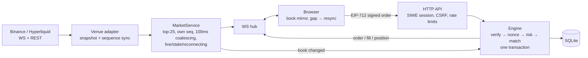

# PaperPerp

A paper-trading terminal for perpetual futures. **Real market data, real
wallet sign-in and EIP-712 signed orders, simulated fills.** Built to
practise the parts of a trading front end that matter in production:
real-time data consistency, signature security, order lifecycle, failure
handling, deployment and observability.

[中文说明](README.zh-CN.md) · [Architecture](docs/architecture.md) · [Runbook](docs/runbook.md) · [ADRs](docs/adr)


## What it does

- **Live BTC-PERP market** from Binance USDⓈ-M (or Hyperliquid): order book,
  trades tape and 1m candles, streamed through the gateway over WebSocket.
- **Sign-In with Ethereum** (EIP-4361) with any EIP-6963 browser wallet;
  10,000 paper USDC per account.
- **EIP-712 signed orders and cancels** (limit GTC, market as IOC with a
  slippage cap, reduce-only), verified server-side with replay protection
  and idempotent retries.
- **1-click trading**: approve a browser-generated agent key once; later
  orders are signed locally with no wallet popup.
- **Simulated matching** against the live book: taker fills walk the
  levels, resting limits fill as maker when the market crosses them;
  positions, PnL, fees and margin.
- **Read-only degradation**: when the feed is stale or reconnecting,
  trading pauses and the UI explains why; it recovers without a reload.

## Architecture



Monorepo (pnpm): `packages/shared` holds everything both sides must agree
on (EIP-712 types, order book sequencing, order state machine, WS protocol),
`apps/gateway` (Node 24, Hono, ws, node:sqlite, pino, prom-client) and
`apps/web` (React 19, Vite, wagmi 3, viem, TanStack Query, Zustand,
lightweight-charts). Details in [docs/architecture.md](docs/architecture.md).

## Design decisions

| ADR | Decision |
| --- | --- |
| [0001](docs/adr/0001-simulated-matching-on-real-market-data.md) | Real market data and real signatures, simulated matching. |
| [0002](docs/adr/0002-gateway-owned-book-sequencing.md) | Gateway owns book sequencing: coalesced top-25 deltas with `prevSeq/seq/epoch`. |
| [0003](docs/adr/0003-eip712-orders-replay-protection-agent-keys.md) | EIP-712 orders, `(signer, nonce)` replay table with idempotent retries, agent keys. |
| [0004](docs/adr/0004-wallet-connection-wagmi3-eip6963.md) | wagmi 3 + EIP-6963 instead of RainbowKit. |
| [0005](docs/adr/0005-single-process-sqlite.md) | One process + SQLite; atomicity from a synchronous critical section. |
| [0006](docs/adr/0006-fixed-point-at-the-signing-boundary.md) | Exact fixed-point (bigint, 1e8) at the signing boundary. |

## Verified behaviour

Each of these is covered by an automated test or measured with the scripts
in `scripts/` (numbers from 2026-11-17, see the [runbook](docs/runbook.md)).

| Requirement | Result | How it is checked |
| --- | --- | --- |
| Upstream disconnect recovers without a page reload | Back to `live` in ~1.2 s; client book matches the server snapshot ~5 ms later | `pnpm chaos`, Playwright `degrades to read-only…` |
| Lost upstream message never reaches clients | Gateway resyncs from REST; 0 client resyncs | `pnpm chaos` (`gap`), Binance sync unit tests |
| Stale feed pauses trading and explains why | Status `stale`, order button disabled, banner shown | Playwright `marks the feed stale…` |
| The same signed order submitted twice fills once | Second request returns the original order (`duplicate: true`) | Parallel-submit test in `trading.test.ts` |
| Expired, reused-nonce and wrong-chain signatures are rejected with a clear error | `expired`, `nonce_reused` (409), `wrong_chain` / `signer_not_authorized` | `trading.test.ts` |
| SIWE replay and phishing domains rejected | Single-use nonce, domain/URI/chain allow lists | `trading.test.ts` |
| 1,000 concurrent WebSocket clients | p99 delivery 23 ms, 0 gaps, ~170 MB RSS | `pnpm loadtest` |
| Full user flow in a real browser | Connect → SIWE → market buy → agent key → limit → cancel → close | Playwright with an EIP-6963 test wallet |

## Run it

Requirements: Node 24, pnpm 10.

```bash
pnpm install
pnpm dev          # gateway :8787 (live Binance) + web :5173
pnpm dev:mock     # same, with the offline mock venue
```

Open http://localhost:5173 with MetaMask or Rabby. The app uses Arbitrum
Sepolia as the signing chain (no funds or transactions needed).

```bash
pnpm lint && pnpm typecheck && pnpm test   # Biome, tsc, Vitest (37 tests)
pnpm e2e                                   # Playwright; first run: pnpm --filter @paperperp/web exec playwright install chromium
pnpm loadtest -- --clients 1000            # needs a running gateway
pnpm chaos                                 # needs ENABLE_FAULT_INJECTION=true
```

Docker (gateway + web in one image, Caddy for HTTPS, optional Prometheus and Grafana):

```bash
cp .env.example .env
DOMAIN=perp.example.com docker compose up -d --build
docker compose --profile monitoring up -d
```

Deployment, rollback, alerts and drills: [docs/runbook.md](docs/runbook.md).

## Security notes

- Private keys never leave the wallet; the agent key can only trade this
  paper account, expires in 24 h and can be revoked (trade-offs in ADR-0003).
- Session cookie is opaque, `HttpOnly`, `SameSite=Lax`, `Secure` in prod.
  CORS/CSRF allow lists, Origin check on WebSocket upgrades, strict CSP,
  zod validation on every body, per-IP and per-account rate limits.
- Logs redact session ids and signatures.

## Not in scope (yet)

Liquidations, funding, configurable leverage, multiple markets in the UI,
smart-contract wallet signatures (ERC-1271), WalletConnect, a real
execution venue adapter, horizontal scaling (see ADR-0005).
