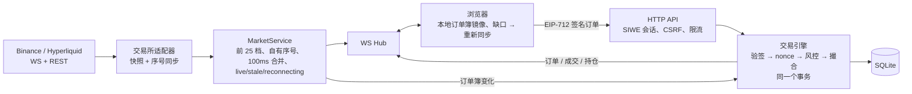

# PaperPerp（中文说明）

模拟永续合约交易终端。**行情是真实的，钱包登录和 EIP-712 签名下单是真实的，成交是模拟的。**做这个项目，是为了把交易前端在生产环境里真正要面对的几件事完整走一遍：实时数据的一致性、签名安全、订单生命周期、异常处理、部署和可观测性。

[English](README.md) · [架构](docs/architecture.md) · [运维手册](docs/runbook.md) · [架构决策记录 ADR](docs/adr)

## 功能

- **BTC-PERP 实时行情**：来自 Binance U 本位合约（也可以切换到 Hyperliquid），包括订单簿、逐笔成交和 1 分钟 K 线，由 gateway 统一处理后通过 WebSocket 推给浏览器。
- **以太坊签名登录（SIWE，EIP-4361）**：支持任何 EIP-6963 浏览器钱包，每个账户初始有 10,000 模拟 USDC。
- **EIP-712 签名下单和撤单**：支持限价单（GTC）、市价单（IOC，带最大滑点）和只减仓。服务端验签，防重放，重复提交是幂等的。
- **一键交易**：主钱包授权一次浏览器生成的临时交易密钥（agent），之后的订单在本地签名，不再弹钱包。
- **模拟撮合**：吃单沿真实盘口逐档成交；挂单在市场价格穿过时按 maker 成交。计算持仓、盈亏、手续费和保证金。
- **只读降级**：行情过期或断线时自动暂停交易，界面说明原因，恢复后不用刷新页面。

## 架构



pnpm monorepo 分三块：

- `packages/shared`：前后端必须一致的东西，包括 EIP-712 类型、订单簿序号逻辑、订单状态机和 WS 协议。
- `apps/gateway`：Node 24、Hono、ws、node:sqlite、pino、prom-client。
- `apps/web`：React 19、Vite、wagmi 3、viem、TanStack Query、Zustand、lightweight-charts。

## 关键设计

1. **gateway 自己管订单簿序号**（ADR-0002）。上游怎么推是上游的事：gateway 保存完整订单簿，每 100ms 把前 25 档和上次发布的结果比对，生成带 `prevSeq/seq/epoch` 的增量。客户端只认 gateway 的序号，所以上游丢包时由 gateway 自己从 REST 重新同步，客户端完全无感知。
2. **Binance 增量深度同步**：先缓冲事件，再拉 REST 快照。快照之后的第一条事件必须跨过 `lastUpdateId`（U ≤ id ≤ u），之后每条事件的 `pu` 都必须等于上一条的 `u`。这里踩过一个真实的坑：第一条事件的 `pu` 不能拿来和快照 id 比较，否则每 200ms 就会误判一次缺口（见提交 `2a4e809`）。
3. **签名防重放和幂等**（ADR-0003）。`used_nonces(signer, nonce)` 表记录请求的 typed data 哈希：同一个签名再交一次，返回原订单；同一个 nonce 换了内容，返回 409。验签之后的流程（nonce 检查、风控、撮合、落库）在一段同步代码里、同一个 SQLite 事务中完成，所以并发重复提交也只会成交一次（有并发测试覆盖）。
4. **事件在提交之后才推送**：引擎把事件先放进 outbox，事务提交后才推到 WebSocket，客户端不会看到被回滚的成交。
5. **前端渲染性能**：高频增量直接写进本地订单簿镜像，每个动画帧最多更新一次 React；标签页在后台时不渲染。K 线的实时更新直接调用图表 API，不经过 React 状态。
6. **统一的交易闸门**：钱包未连接、未登录、钱包切换了账户、网络不对、行情不可用，各有对应的提示和操作入口，集中在 `useTradingGate` 里判断。

## 验收结果

| 要求 | 结果 | 验证方式 |
| --- | --- | --- |
| 上游断线后不刷新页面也能恢复 | 约 1.2 秒回到 live，之后约 5ms 客户端订单簿和服务端快照一致 | `pnpm chaos`、Playwright |
| 上游丢包不影响客户端 | gateway 自己重新同步，客户端重新同步 0 次 | `pnpm chaos`（gap）、单元测试 |
| 行情过期时暂停交易并说明原因 | 状态变为 stale，下单按钮禁用，显示横幅 | Playwright |
| 同一个签名订单提交两次只成交一次 | 第二次返回原订单（`duplicate: true`） | 并发提交测试 |
| 过期、nonce 重复、错链的签名被拒绝，且错误信息明确 | `expired`、`nonce_reused`、`wrong_chain` / `signer_not_authorized` | 单元/集成测试 |
| 1000 个并发 WebSocket 客户端 | p99 投递延迟 23ms，0 缺口，内存约 170MB | `pnpm loadtest` |
| 真实浏览器里走通完整流程 | 连接 → SIWE → 市价买入 → 启用 agent → 限价单 → 撤单 → 平仓 | Playwright + EIP-6963 测试钱包 |

## 本地运行

```bash
pnpm install
pnpm dev          # gateway :8787（Binance 实时行情）+ web :5173
pnpm dev:mock     # 离线模拟行情
pnpm lint && pnpm typecheck && pnpm test
pnpm e2e
```

部署、回滚、告警和演练见 [docs/runbook.md](docs/runbook.md)。

## 暂未实现

强平、资金费率、可调杠杆、多市场界面、合约钱包签名（ERC-1271）、WalletConnect、真实交易所下单适配器、水平扩展（见 ADR-0005）。
