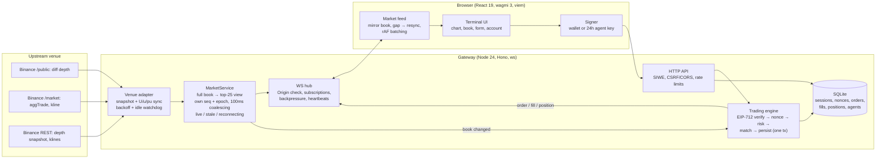
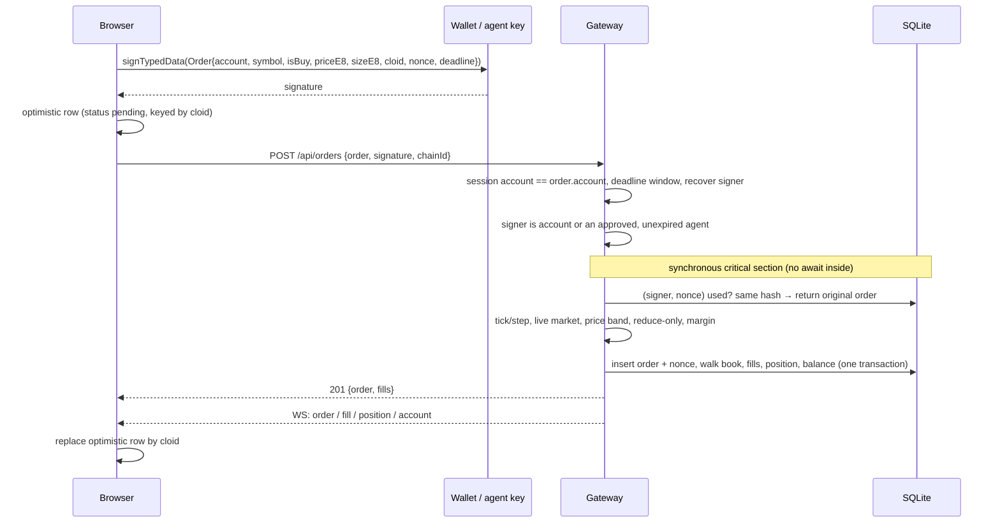

# Architecture

PaperPerp is a paper-trading terminal for perpetual futures. Market data is
real (Binance USDⓈ-M or Hyperliquid); order entry, authentication and
signing are real; matching is simulated against the live book.

## Packages

| Path              | What lives there                                                                                                                                                                         |
| ----------------- | ---------------------------------------------------------------------------------------------------------------------------------------------------------------------------------------- |
| `packages/shared` | Everything both sides must agree on: EIP-712 types and wire format, order book with sequencing, order state machine, WS protocol, DTOs, error codes, market config, fixed-point helpers. |
| `apps/gateway`    | Venue adapters, market service, WS hub, SIWE auth, trading engine, SQLite store, HTTP API, metrics.                                                                                      |
| `apps/web`        | Vite + React app. Market feed store, wallet/SIWE/agent hooks, trading UI, Playwright e2e.                                                                                                |
| `scripts`         | Load test, chaos drill, SSH deploy.                                                                                                                                                      |
| `deploy`          | Caddy, Prometheus rules, Grafana dashboard, single-host compose.                                                                                                                         |

## Market data path

1. **Venue adapter** (e.g. `market/binance.ts`) buffers diff-depth events,
   fetches a REST snapshot, applies the first event that straddles
   `lastUpdateId`, then requires `pu == previous u` for every event. A
   mismatch triggers a resync. Trades and klines come from a second socket.
   Both sockets reconnect with jittered exponential backoff and an idle
   watchdog.
2. **MarketService** keeps the full upstream book, and every 100 ms diffs the
   top 25 levels against what it last published. Non-empty diffs become a
   `book.delta` with the gateway's own `prevSeq → seq`. Clients never see
   venue sequence numbers, so an upstream resync is invisible to them.
3. **Status**: `reconnecting` (socket down or no snapshot yet) → `live` →
   `stale` (no data for `STALE_AFTER_MS`). Every change is pushed on the
   book channel and exported as the `market_live` gauge.
   A browser streams the book, trades and candles of the one market it is
   showing. The `tickers` channel carries every market's mid and status once
   a second, so positions in other markets are still marked live.
4. **WS hub** serialises each message once and fans it out. Clients whose
   send buffer exceeds 1 MB are dropped, and clients silent for 45 s are
   swept. The upgrade is refused for unknown `Origin`s, which protects
   against cross-site WebSocket hijacking because the session cookie rides
   on the upgrade.
5. **Browser feed** mirrors the book: snapshot, then deltas only if
   `prevSeq == seq`. On a gap or an epoch change it sends `resync` and
   drops deltas until the new snapshot arrives. React is updated at most
   once per animation frame.

## Order path

Resting limit orders are re-checked every time the published book changes;
when the market crosses them they fill as maker at their limit price.

## Failure handling

| Failure                                                | Behaviour                                                                                                      |
| ------------------------------------------------------ | -------------------------------------------------------------------------------------------------------------- |
| Upstream socket drops                                  | Status → `reconnecting`, trading paused, banner in UI; reconnect with backoff, REST snapshot, status → `live`. |
| Upstream message lost                                  | `pu` mismatch → adapter resyncs from REST; clients unaffected (gateway sequence stays continuous).             |
| Upstream silent                                        | Idle watchdog / stale timer → `stale`, trading paused, UI explains why.                                        |
| Client misses a delta                                  | Client detects `prevSeq` gap → `resync` → fresh snapshot.                                                      |
| Gateway restarts                                       | New `epoch`; clients reconnect, resubscribe and take a snapshot; working orders reload from SQLite.            |
| Duplicate order submit (retry, double click, two tabs) | Same `(signer, nonce)` + same typed-data hash → original order returned, no second fill.                       |
| Network timeout after the order filled                 | Client retry with the same signature is idempotent; WS push and refetch on reconnect reconcile the UI.         |
| Wallet switches account or chain                       | Trading gate blocks with a specific reason and action (sign in again / switch network).                        |
| Slow WebSocket consumer                                | Dropped once its buffer passes 1 MB; it reconnects and resyncs.                                                |

## Scaling notes

The gateway is one process by design (see ADR-0005). To scale out:
Postgres instead of SQLite, a row lock or advisory lock per account for
the critical section, Redis for rate limits and nonce caching, market
data fan-out moved to a separate stateless tier fed by one ingester per
venue, and matching sharded by symbol.
